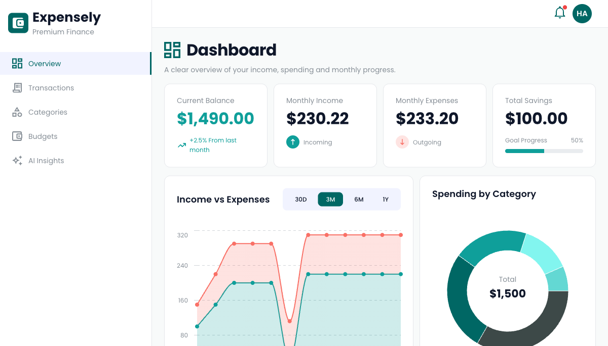
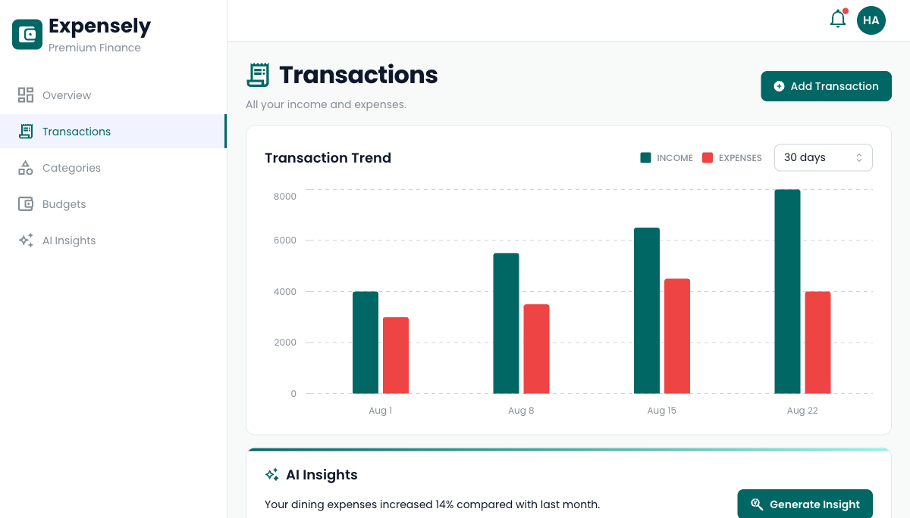
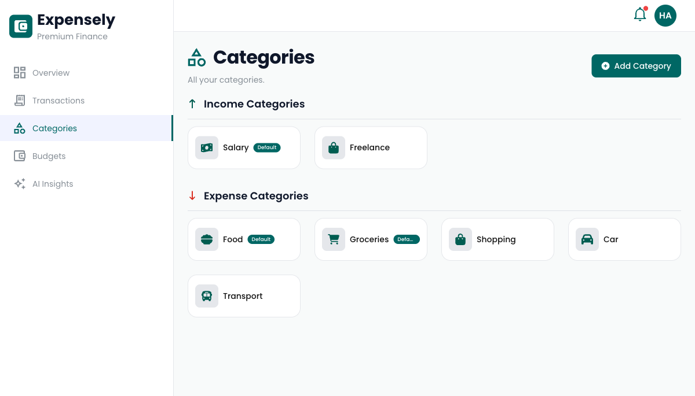
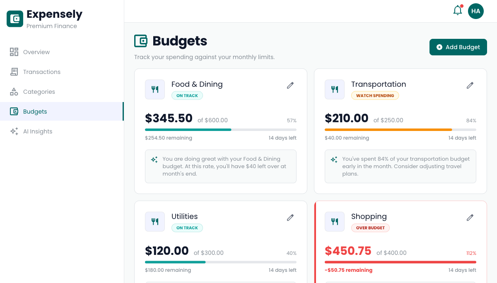

# Personal Finance Dashboard

A responsive personal finance dashboard built with React and TypeScript. It brings income and expense summaries, transaction activity, category spending, monthly budgets, and financial insights into one interface, with English and Arabic localization.

## Screenshots

### Dashboard



### Transactions



### Categories and budgets

| Categories | Budgets |
| --- | --- |
|  |  |

## What’s in the app

- **Dashboard:** income and expense summaries, charts, budget status, spending by category, and recent transactions.
- **Transactions:** transaction table and details, transaction trends, and a form for adding income or expenses.
- **Categories:** separate income and expense categories, with a category creation form.
- **Budgets:** monthly budget cards and a form for setting spending limits.
- **AI Insights:** financial overview, monthly summary, savings tips, and recent analyses.
- **Settings:** profile, security, language and currency preferences, and account actions.
- **Authentication screens:** login and sign-up layouts.

## Project status

This repository currently contains the frontend app and its UI flows. Dashboard charts, transactions, categories, and insight content are backed by local fixtures. Authentication is a placeholder, and the app does not yet connect these screens to a production account or finance service.

## Built with

- React 19, TypeScript, and Vite
- Mantine for UI components and forms
- React Router for localized routes and page layouts
- TanStack Query and TanStack Table
- Recharts and Mantine Charts
- i18next and react-i18next for English and Arabic
- Zod for form validation

## Run locally

Requires Node.js `>=22.12.0` and Bun.

```bash
bun install
bun run dev
```

Vite prints the local development URL after the server starts.

## Scripts

| Command | Description |
| --- | --- |
| `bun run dev` | Start the Vite development server |
| `bun run build` | Type-check and build for production |
| `bun run preview` | Preview the production build locally |
| `bun run lint` | Run Oxlint |
| `bun run generate:icons` | Generate React icon components from `src/assets/svg-source/` |

## Code layout

- `src/features/` contains dashboard, transaction, category, budget, insight, and settings UI.
- `src/pages/` maps route entries to feature screens.
- `src/layouts/` contains the dashboard and authentication layouts.
- `src/fixtures/` contains sample chart, transaction, category, and insight data.
- `src/translations/` contains English and Arabic strings.
